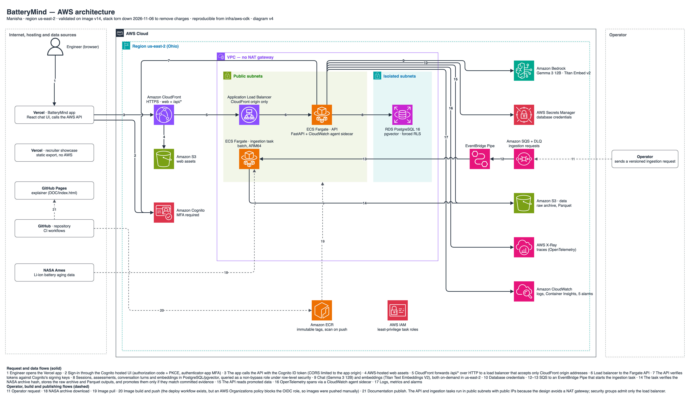
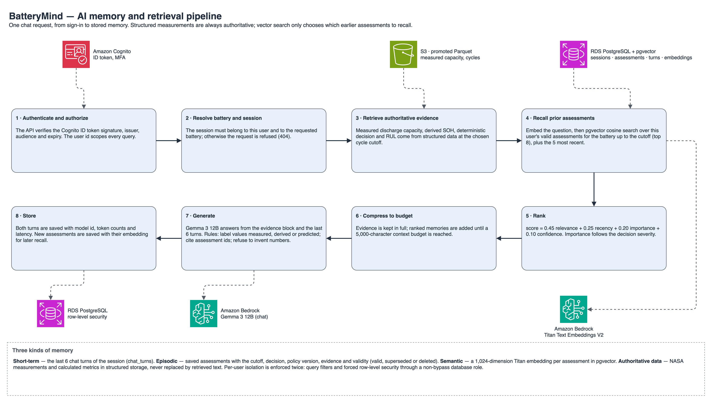
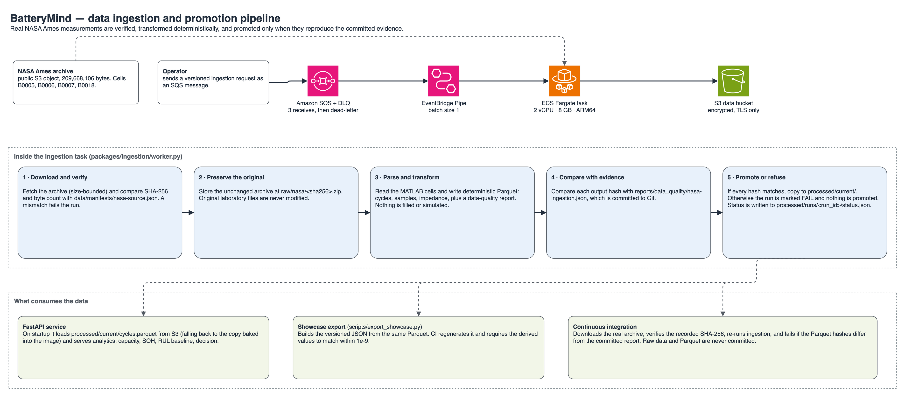
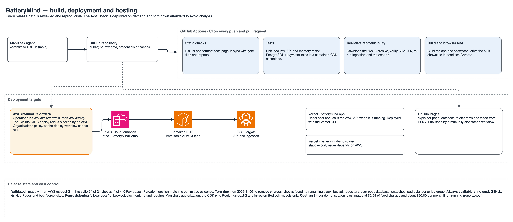

# BatteryMind

### Evidence-grounded battery reliability intelligence on AWS

BatteryMind turns authentic NASA Ames battery-aging experiments into cutoff-aware degradation analytics,
transparent remaining-life baselines, deterministic engineering decisions, and an AI assistant that remembers
earlier assessments without treating generated text as evidence.

[Explore the live showcase](https://batterymind-showcase.vercel.app) ·
[Read the technical case study](https://manisa504.github.io/batterymind-aws-ai-battery-reliability-intelligence/) ·
[Watch the 95-second overview](DOC/assets/batterymind-brag.mp4)

> The AWS system was deployed, tested end to end in `us-east-2`, and intentionally removed after validation to
> avoid ongoing charges. The static showcase, documentation, source, diagrams, and test evidence remain public.

## What this project demonstrates

- **Scientific data discipline:** source checksum verification, immutable raw archives, preserved units and source
  indices, explicit missingness, and deterministic Parquet transformations.
- **Honest predictive analytics:** measured capacity and SOH stay distinct from linear RUL estimates and bootstrap
  uncertainty. Evaluation uses chronological cutoffs and battery-disjoint comparisons where feasible.
- **Controlled AI:** a versioned rules engine makes the engineering classification. Bedrock explains the result;
  it cannot invent measurements or override policy.
- **Durable, isolated memory:** PostgreSQL and pgvector store user-owned sessions, assessments, corrections, and
  evidence references with row-level isolation, idempotency, and deletion semantics.
- **Production engineering:** React, FastAPI, Docker, CDK, Cognito MFA, ECS Fargate, RDS, SQS, Bedrock,
  CloudWatch/X-Ray, CI, browser tests, and auditable release gates.

## Product tour

The independent [recruiter showcase](https://batterymind-showcase.vercel.app) works without AWS or sign-in. Choose
a cell, move the historical cutoff, inspect measured capacity and SOH, compare cells, and review the decision and
RUL baseline. The full React application additionally implements authenticated assistant conversations, assessment
history, correction/deletion, evaluation results, and operating-cost evidence.

| Verified release fact | Result | Evidence |
|---|---:|---|
| NASA cells / discharge cycles / samples | 4 / 2,167 / 2,089,050 | [Data-quality report](reports/data_quality/nasa-ingestion.json) |
| Live AWS acceptance checks | 24 / 24 passed | [Live test report](reports/performance/live-performance.json) |
| Traced public requests | 4 / 4 in X-Ray | [Trace report](reports/performance/otel-traces.json) |
| AWS ingestion reproducibility | Byte-identical Parquet | [AWS ingestion report](reports/data_quality/aws-ingestion.json) |
| Current release gates | G0–G7 PASS | [Gate evidence](docs/gates) |

## Architecture

The four diagrams below are the complete architecture set. Every diagram is available as PNG/SVG and as editable
draw.io source.

### 1. AWS production system



CloudFront separates private static delivery from `/api/*`; Cognito protects user workflows; an ECS Fargate API
uses private PostgreSQL/pgvector, Bedrock, and authoritative S3 evidence. SQS and EventBridge Pipes launch bounded
ingestion tasks. CloudWatch, OpenTelemetry, and X-Ray provide operational evidence.

[Editable draw.io](DOC/architecture/batterymind-aws.drawio) · [SVG](DOC/architecture/batterymind-aws.svg) ·
[Architecture guide](DOC/architecture/batterymind-aws.md)

### 2. Evidence-grounded memory



Each request authenticates the user and resolves the battery and historical cutoff before retrieving numerical
evidence. Only then does the system recall valid user-owned memories, rank and compress them, generate an explanation,
and persist the conversation. Structured measurements remain authoritative.

[Editable draw.io](DOC/architecture/batterymind-memory.drawio) · [SVG](DOC/architecture/batterymind-memory.svg)

### 3. Data ingestion and promotion



The worker verifies the NASA archive, preserves the source unchanged, parses cycle/sample/impedance tables, validates
quality and units, and promotes deterministic Parquet only when output hashes match the committed evidence.

[Editable draw.io](DOC/architecture/batterymind-data.drawio) · [SVG](DOC/architecture/batterymind-data.svg)

### 4. Delivery and publication



GitHub CI rebuilds the evidence and tests the system. AWS deployment uses a reviewed CDK diff; GitHub Pages publishes
the case study; Vercel independently hosts the app shell and credential-free showcase.

[Editable draw.io](DOC/architecture/batterymind-delivery.drawio) · [SVG](DOC/architecture/batterymind-delivery.svg)

## Engineering design

### Analytics and policy

`SOH = measured discharge capacity ÷ 2 Ah × 100`. The RUL baseline fits a linear trend using only measurements at or
before the selected cutoff and estimates uncertainty from training residuals. The experiment-specific EOL threshold
is 1.4 Ah. The `experimental-soh-v1` policy maps SOH to `CONTINUE_MONITORING`, `INCREASE_TESTING`,
`ENGINEERING_REVIEW`, or `EOL_REVIEW`; insufficient evidence always takes precedence. Intermediate bands are project
defaults, not NASA recommendations.

### Memory and security

Numerical evidence is retrieved before semantic memory. Recall is filtered by user, battery, validity, and historical
cutoff, then ranked within a fixed context budget. Corrections supersede prior records; deletion removes associated
turns and embeddings. Cognito MFA, JWT verification, PostgreSQL row-level security, isolated RDS networking,
least-privilege roles, encrypted storage, bounded inference, and input limits protect the deployed workflow.

### API and applications

- `apps/api`: versioned FastAPI endpoints for batteries, cutoff analysis, sessions, assessments, chat, memory,
  evaluation, and usage.
- `apps/web`: production React/TypeScript workspace with Overview, Analysis, Assistant, Decision History, and
  Evaluation views.
- `showcase`: credential-free React application built from a versioned, validated public export.

## Run locally

```bash
python3 -m venv .venv && source .venv/bin/activate
make install
make ingest                        # expects .local-data/nasa-battery-data.zip
make test
./scripts/test_postgres.sh         # ephemeral PostgreSQL + pgvector validation
npm --prefix apps/web ci && npm --prefix apps/web run build
npm --prefix showcase ci && npm --prefix showcase run build
```

The archive URL, byte count, and SHA-256 are recorded in
[`data/manifests/nasa-source.json`](data/manifests/nasa-source.json). Raw data, credentials, generated caches, and
private memories are excluded from Git.

## Repository map

| Path | Purpose |
|---|---|
| [`apps/`](apps) | FastAPI service and production React application |
| [`showcase/`](showcase) | Independent public portfolio experience |
| [`packages/`](packages) | Ingestion, analytics, prediction, policy, memory, and evaluation libraries |
| [`infra/aws-cdk/`](infra/aws-cdk) | Python CDK infrastructure and security assertions |
| [`DOC/`](DOC) | GitHub Pages case study, diagrams, and overview video |
| [`docs/`](docs) | Product requirements, ADRs, risks, gates, and runbooks |
| [`reports/`](reports) | Executed data, model, memory, performance, cost, security, and release evidence |
| [`tests/`](tests) | Unit, integration, PostgreSQL, security, browser, and live E2E suites |

## Limitations

- Four laboratory cells cannot establish broad model generalization or field safety.
- The linear RUL model is an interpretable baseline and does not outperform persistence on every cell.
- The authenticated AWS backend is offline by design; redeployment requires paid-resource authorization.
- An AWS Organizations policy prevented creation of a GitHub Actions OIDC provider, so validated AWS releases used
  manual deployment from a reviewed CDK diff.
- The NASA catalog does not state a license; the project retains attribution and provenance.

## Ownership and attribution

Designed and built by **Manisha**. Data: NASA Ames Prognostics Center of Excellence,
[Li-ion Battery Aging Datasets](https://data.nasa.gov/dataset/li-ion-battery-aging-datasets).
