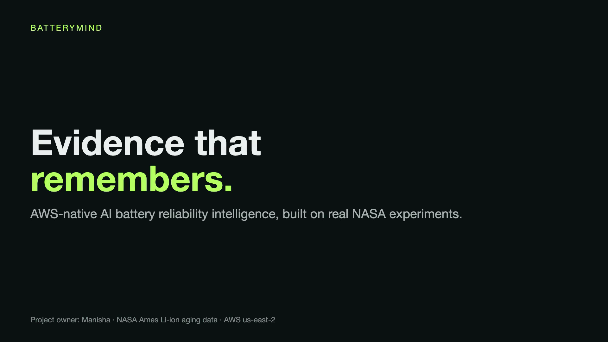

# BatteryMind — AWS-native AI battery reliability intelligence

**BatteryMind turns real NASA battery-aging experiments into traceable measurements, transparent analytics,
versioned engineering decisions, and an AI assistant that remembers earlier assessments.**
Built by Manisha as an engineering portfolio project: real data, production-style AWS infrastructure, and every
claim backed by an executed test or a committed report.

[](DOC/assets/batterymind-brag.mp4)

| | |
|---|---|
| **Explainer (GitHub Pages)** | https://manisa504.github.io/batterymind-aws-ai-battery-reliability-intelligence/ |
| **Interactive showcase** (no sign-in, no AWS needed) | https://batterymind-showcase.vercel.app |
| **Chat application** (needs the AWS stack running) | https://batterymind-app.vercel.app |
| **Overview video** | [`DOC/assets/batterymind-brag.mp4`](DOC/assets/batterymind-brag.mp4) |

> **Status.** The full AWS stack was deployed in `us-east-2`, validated end to end, and then **deliberately torn down
> on 2026-11-06 to avoid charges**. GitHub, the explainer, the showcase and all evidence remain available at no
> cost; the chat application needs the stack redeployed ([how](docs/runbooks/deployment.md)).

---

## The problem

Battery validation teams collect large volumes of aging data but struggle to keep analysis history, compare
degradation across cycles, and explain why an earlier engineering decision was made. BatteryMind answers:

- Which cells show the greatest measured degradation, and how has a specific cell's capacity changed?
- Which cells are approaching the experiment's end-of-life threshold, and what remaining life can the data support?
- What did we conclude last session, what changed since, and what action does the evidence support?

It classifies each cell with a **versioned, deterministic policy** — `CONTINUE_MONITORING`, `INCREASE_TESTING`,
`ENGINEERING_REVIEW`, `EOL_REVIEW` or `INSUFFICIENT_EVIDENCE`. The language model **explains** the decision and recalls
history; it never makes the decision and never supplies a number. These are laboratory observations, not
field-proven safety or maintenance outcomes.

## What was verified

Every figure links to a committed report. Gates use only **PASS / FAIL / BLOCKED**.

| Claim | Evidence |
|---|---|
| Real data: 4 NASA Ames cells (B0005, B0006, B0007, B0018), 2,167 cycles, 2,089,050 samples, archive SHA-256 verified | [`reports/data_quality/nasa-ingestion.json`](reports/data_quality/nasa-ingestion.json) |
| Ingestion reproduced on AWS Fargate in 13.5 s, byte-identical to the committed evidence, then promoted | [`reports/data_quality/aws-ingestion.json`](reports/data_quality/aws-ingestion.json) |
| Live suite on AWS: **24 of 24** checks passed — MFA sign-in, evidence-grounded chat, pgvector recall across sessions, correction, concurrent writes, cross-user isolation, recall after a forced container restart | [`reports/performance/live-performance.json`](reports/performance/live-performance.json) |
| OpenTelemetry traces: 4 of 4 live requests visible in AWS X-Ray | [`reports/performance/otel-traces.json`](reports/performance/otel-traces.json) |
| RUL baselines evaluated chronologically (no future data) and leave-one-cell-out | [`reports/model_evaluation/rul-baselines.json`](reports/model_evaluation/rul-baselines.json) |
| Security tests (token forgery, impersonation, route auth, input, CORS) and infrastructure assertions | [`tests/security/`](tests/security), [`infra/aws-cdk/tests/`](infra/aws-cdk/tests) |
| CI re-downloads the real archive, verifies its checksum and re-runs ingestion on every push | [`.github/workflows/ci.yml`](.github/workflows/ci.yml) |
| Cost model: about $2.95 of fixed charges for an 8-hour demo; about $60.80 per month if left running | [`reports/cost/`](reports/cost) |

| Gate | Scope | Status |
|---|---|---|
| G0 | Product and requirements | PASS |
| G1 | Real dataset validation | PASS |
| G2 | AWS architecture | PASS |
| G3 | Battery analytics | PASS |
| G4 | Persistent memory | PASS |
| G5 | AWS production application | PASS |
| G6 | Independent showcase | PASS |
| G7 | Documentation and release | PASS — the optional GitHub Actions deploy role is waived (see Limitations) |

Details and open items: [`docs/gates/`](docs/gates).

## Architecture

### AWS production architecture


CloudFront serves the web assets and forwards `/api/*` to a load balancer that accepts only CloudFront origin
addresses. The FastAPI service runs on ECS Fargate (ARM64) and verifies Cognito ID tokens (MFA required) on every
protected request. State lives in private RDS PostgreSQL with pgvector. Chat uses Amazon Bedrock (Gemma 3 12B) and
embeddings use Titan Text Embeddings V2, both on-demand in `us-east-2`. Ingestion runs as an SQS → EventBridge Pipe →
Fargate batch task. Traces flow through a CloudWatch agent sidecar to X-Ray; five CloudWatch alarms watch the API,
database and dead-letter queue. The infrastructure is AWS CDK (Python) with cdk-nag checks.
Editable source: [`DOC/architecture/batterymind-aws.drawio`](DOC/architecture/batterymind-aws.drawio) ·
[SVG](DOC/architecture/batterymind-aws.svg) · [guide](DOC/architecture/batterymind-aws.md).

### AI memory and retrieval pipeline


Each chat request authenticates the user, resolves the battery and session, retrieves the **authoritative**
measurements, recalls valid earlier assessments (pgvector similarity plus recency), ranks them
(0.45 relevance + 0.25 recency + 0.20 importance + 0.10 confidence), compresses to a 5,000-character budget, asks
Gemma 3 12B to answer from that evidence, and stores the turns. Source: [`DOC/architecture/batterymind-memory.drawio`](DOC/architecture/batterymind-memory.drawio).

### Data ingestion and promotion pipeline


The task verifies the archive hash, keeps the original file untouched, writes deterministic Parquet, compares every
output hash with the committed report, and **promotes only on an exact match**. Source: [`DOC/architecture/batterymind-data.drawio`](DOC/architecture/batterymind-data.drawio).

### Build, deployment and hosting


CI runs on every push; AWS is deployed manually from a reviewed diff; Pages and Vercel are published separately.
Source: [`DOC/architecture/batterymind-delivery.drawio`](DOC/architecture/batterymind-delivery.drawio).

## How it works

**Data.** Authentic NASA Ames lithium-ion aging experiments (B0005, B0006, B0007, B0018). Original files are preserved
unchanged; source URL, byte count and SHA-256 are in [`data/manifests/nasa-source.json`](data/manifests/nasa-source.json). Missing values are
recorded, never filled. Raw archives and Parquet are not committed; ingestion regenerates them.

**Analytics.** `SOH = measured discharge capacity ÷ 2 Ah × 100`. Degradation rate is the measured slope. The RUL baseline is a
linear trend with a residual-bootstrap interval, evaluated chronologically and leave-one-cell-out. The NASA 1.4 Ah
end-of-life criterion is applied only to these 2 Ah cells and is not generalized.

**Decision policy** (`experimental-soh-v1`, deterministic and versioned): SOH ≤ 70 % → `EOL_REVIEW`; ≤ 75 % →
`ENGINEERING_REVIEW`; ≤ 85 % → `INCREASE_TESTING`; otherwise `CONTINUE_MONITORING`; fewer than two valid
measurements → `INSUFFICIENT_EVIDENCE`. Only the 70 % line corresponds to the NASA experiment; the other bands are project-defined.

**Memory.** Short-term (last 6 turns), episodic (saved assessments with cutoff, decision, policy and evidence,
valid / superseded / deleted), and semantic (1,024-dimension embeddings in pgvector). Measured values stay in
structured storage; vector search never supplies a number.

**API** (`/api/v1`): `GET /batteries`, `/batteries/{id}/analysis?cutoff=`, `/evaluation` (public); with a Cognito ID
token: `POST /sessions`, `/assessments`, `/chat`; `GET /batteries/{id}/history`, `/batteries/{id}/sessions`,
`/sessions/{id}/turns`, `/usage`; `DELETE /assessments/{id}`, `/sessions/{id}`.

**Web app** (`apps/web`, React + TypeScript): Overview, Analysis (capacity, voltage and temperature profiles,
measured-versus-predicted trajectory, RUL with uncertainty), Assistant, Decision history (record, correct, delete) and Evaluation (error tables, memory tests, usage, operating-cost inventory).

**Showcase** (`showcase/`): a separate static site built from a versioned export of the verified data. It has no
connection to AWS, so it works even when the stack is off.

## Security

Cognito with required authenticator-app MFA and admin-only sign-up · JWT signature, issuer, audience, expiry and
`token_use` verified in the API · per-user PostgreSQL row-level security through a non-bypass role, applied
for every transaction · RDS in isolated subnets, encrypted · credentials in Secrets Manager · least-privilege task
roles, Bedrock limited to two `us-east-2` model ARNs · immutable, scanned ECR images · S3 public access blocked and TLS
required · bounded inputs and model output. Known gaps are listed under *Limitations*.

## Run it locally

```bash
python3 -m venv .venv && source .venv/bin/activate
make install                       # Python dependencies
make ingest                        # needs the archive at .local-data/nasa-battery-data.zip (SHA-256 is checked)
make test                          # unit, security, API and memory tests
./scripts/test_postgres.sh         # PostgreSQL + pgvector tests in a throwaway container
npm --prefix apps/web install && npm --prefix apps/web run build
npm --prefix showcase install && npm --prefix showcase run build
```

Regenerate the evidence-driven artifacts: `python scripts/build_docs_page.py` (explainer),
`python scripts/build_architecture_diagram.py` and `python scripts/build_more_diagrams.py` (diagrams, need the draw.io CLI),
`python scripts/build_brag_video.py` (video, needs macOS, Chrome and ffmpeg).

## Deploy and tear down

Infrastructure is AWS CDK in [`infra/aws-cdk`](infra/aws-cdk). Paid resources require explicit authorization; see
[`docs/runbooks/deployment.md`](docs/runbooks/deployment.md) and [`docs/CHECKPOINT.md`](docs/CHECKPOINT.md). Teardown
leaves no billable resources. The stack pins Region `us-east-2` and never uses cross-Region Bedrock inference profiles.

## Repository layout

```
apps/api            FastAPI service (auth, analytics, chat, memory endpoints, telemetry)
apps/web            React + TypeScript application (Vercel project batterymind-app)
showcase            independent static recruiter showcase (Vercel project batterymind-showcase)
packages/           ingestion · battery_analytics · prediction · decision_engine · memory_engine · evaluation
infra/aws-cdk       CDK stack and infrastructure tests
data/manifests      source provenance and schema notes (no raw data)
DOC/                GitHub Pages explainer, draw.io diagrams (+ SVG/PNG), overview video
docs/               PRD, ADRs, aspect registry, gate reports, runbooks, risks, handoff checkpoint
reports/            data quality, model evaluation, memory, performance, cost, release evidence
tests/              unit · integration · memory · security · e2e (live) · browser
scripts/            ingestion, exports, publishing, diagram, docs and video builders
```

## Limitations and honest status

- **Small, laboratory-specific dataset.** Four cells cannot establish broad model generalization. The linear RUL
  baseline beats a persistence baseline on some cells and not others ([report](reports/model_evaluation/rul-baselines.json)); errors describe this dataset only.
- **GitHub Actions cannot deploy to AWS** (waived): an AWS Organizations policy denies creating the OIDC provider, so
  deployments are run manually from a reviewed `cdk diff`. This does not affect any other gate.
  fix yet; the affected code paths are not used by this workload.
- **The live backend is currently off** to avoid cost, so the Vercel chat application shows its offline notice until redeployed.
- The API and ingestion tasks run in public subnets with public IPs (no NAT gateway, to control cost); security groups admit only the load balancer.
- The NASA catalog does not state a license; attribution and provenance are retained.

## Attribution

Project owner: **Manisha**. Data: NASA Ames Prognostics Center of Excellence Li-ion battery aging datasets
([catalog](https://data.nasa.gov/dataset/li-ion-battery-aging-datasets)).
